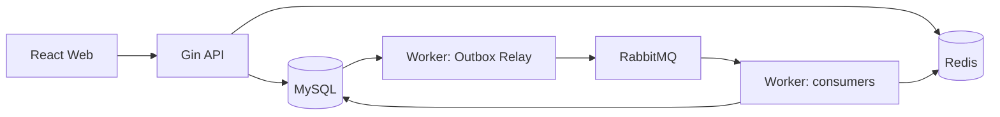

# 架构

两个 Go 进程共享 MySQL、Redis 和 RabbitMQ。API 处理请求，Worker 处理异步投影；它们来自同一个模块，不是独立部署的领域微服务。

## 代码入口

| 目录 | 职责 |
| --- | --- |
| `apps/api/cmd/feed` | 配置、数据库与 HTTP 服务启动 |
| `apps/api/cmd/worker` | Outbox Relay、互动投影、视频预热和文本特征消费 |
| `internal/interfaces/http` | 请求解析、身份校验、路由和响应 |
| `internal/application` | 用例编排、Feed 排序与快照、事件处理 |
| `internal/domain` | 实体、规则及仓储接口 |
| `internal/infra` | MySQL、Redis、RabbitMQ、配置与监控实现 |
| `apps/web/src` | 路由页面、查询状态、播放器与组件 |

## 发布与上传

上传接口要求登录，校验文件大小、扩展名及 MIME。视频另外校验编码、时长和分辨率，并处理 MP4 faststart；每实例最多并行处理两个上传。文件处理成功后登记 `upload_asset`，登记失败删除新文件。

发布事务要求视频和封面属于当前用户且类型正确，然后写入 `video`、`video_stat` 和 `video.published` Outbox 事件。发布幂等键按作者隔离。Worker 分别预热卡片和生成文本特征。发布后直接公开，不存在未实现的审核状态流转。

## 点赞、收藏和评论

`CommitAction` 是点赞/收藏唯一写入口。事务锁定可见视频及互动行，更新行为状态、单调版本与统计，将带 `Delta` 的事件和幂等响应一并提交。历史幂等键返回当时结果，不回退当前状态。

Worker 不改互动事实，也不写一张仅用于记录“收过消息”的表。每次投递先失效统计缓存，再执行通知和热榜投影：

- 点赞通知按视频和互动用户去重，取消后重新点赞不重复通知。
- 热榜通过 Redis Lua 原子去重并更新分钟桶；桶的到期时间由事件发生时间决定，重放不延长历史桶寿命。
- 任一投影失败都会重试；已经成功的部分依赖自己的幂等约束。

评论在事务中更新评论与计数，提交后失效统计缓存，通知与热榜更新为尽力而为。它们尚未进入 Outbox，不能声称和点赞具备相同的故障恢复保证。关注通知也采用同步尽力写入。

## Feed 与推荐

最新流和关注流按发布时间、视频 ID 游标分页。关注流直接关联当前关注关系；卡片与统计批量加载并缓存。装配结果前会过滤已删除视频，避免缓存把已下架内容重新返回。

热门和推荐首屏生成最多 500 条结果的排名快照，后续页只读取该快照。快照绑定用户/场景，过期时间两分钟；只有当前 `s1.` 游标格式有效，过期或旧格式返回 400，客户端需要刷新。

推荐用字符 n-gram 哈希文本向量，与近期观看和互动构造的兴趣特征计算相似度，再结合新鲜度、热度和作者打散。观看事实同步写入数据库，兴趣缓存失效失败时允许一个 TTL 的陈旧。没有在线效果评测或大规模推荐质量结论。

## 事件可靠性

API 不连接 RabbitMQ，Broker 故障不阻止业务事务提交。Worker 的 Relay 用 `SKIP LOCKED` 领取 Outbox 事件，租约带 token；MQ mandatory publish 和 publisher confirm 成功后才标记投递完成。

消费者失败会重试并转入对应 `.failed` 队列。投递确认和数据库更新、消费成功和 ACK 之间都可能发生重复，因此这是至少一次投递。仅接受当前互动事件格式；旧格式不会再驱动数据库写入。

Worker 连接断开时退出，由进程管理器重启。API readiness 检查数据库和 Redis，Worker 还检查 RabbitMQ；API ready 不代表异步任务已经完成。

## 迁移与边界

SQL 迁移记录版本和校验和，已应用的文件不可修改。`004_drop_action_receipts.sql` 删除无用途的旧消费收据表；业务行为、幂等响应和 Outbox 历史保留。升级前停止旧 API/Worker，再执行迁移或启动新版。

当前没有跨区域容灾、对象存储/CDN、大表性能验证、账号管理界面或会话撤销表。具体运维边界见[运维说明](operations.md)，性能结果见[压测基线](performance-baseline.md)。
